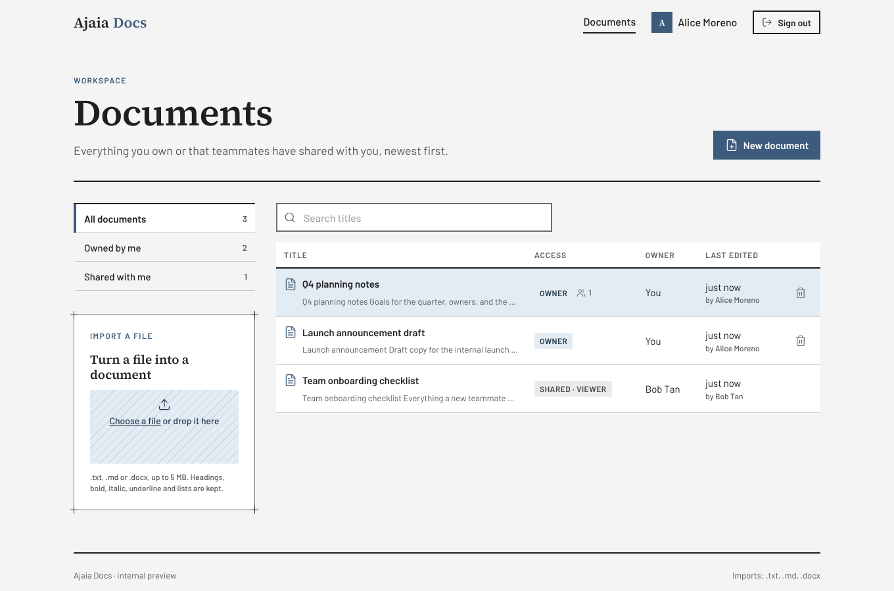

# Ajaia Docs

A lightweight collaborative document editor: create and format documents in the browser, import `.txt` / `.md` / `.docx` files, and share them with teammates as viewers or editors. Built with Laravel 13, Vue 3 (TypeScript) and TipTap, fully Dockerized.



- **Live demo:** `<add your Render URL here>`
- **Walkthrough video:** see [`VIDEO_URL.txt`](VIDEO_URL.txt)
- **Design notes:** [`ARCHITECTURE.md`](ARCHITECTURE.md) · **AI workflow:** [`AI_WORKFLOW.md`](AI_WORKFLOW.md) · **What's included:** [`SUBMISSION.md`](SUBMISSION.md)

## Reviewer accounts

All passwords are `password`. The sign-in page has one-click buttons for each.

| Account | Email | Starting state |
|---|---|---|
| Alice Moreno | `alice@ajaia.test` | Owns *Q4 planning notes* (Bob can edit) and a private *Launch announcement draft*; can view Bob's checklist |
| Bob Tan | `bob@ajaia.test` | Owns *Team onboarding checklist* (Alice can view); can edit Alice's plan |
| Carol Reyes | `carol@ajaia.test` | Nothing shared yet: good for testing sharing from a clean slate |

A quick tour of the sharing flow: sign in as Alice in one browser and Bob in another (or a private window), open *Q4 planning notes* in both, and watch presence, live updates and role changes arrive without refreshing.

## What works

| Area | Behaviour |
|---|---|
| **Documents** | Create, rename (inline title), edit, delete (owner only), reopen. Autosaves ~0.8 s after you stop typing; `Ctrl/Cmd+S` saves immediately. A status shows *Unsaved changes → Saving… → Saved 10:42*. |
| **Formatting** | Bold, italic, underline, strikethrough, headings H1–H3, bulleted and numbered lists, quotes, dividers, undo/redo, keyboard shortcuts. Stored as sanitized HTML, so structure survives reloads exactly. |
| **File import** | **Supported: `.txt`, `.md`/`.markdown`, `.docx`, up to 5 MB.** Import as a new document (drag and drop or file picker on the Documents page), or insert a file at the cursor of an open document (⋯ menu). Headings, bold/italic/underline/strike and lists are preserved. Anything else is rejected with a clear message. |
| **Sharing** | Owner shares by email with **Can edit** or **Can view**, changes roles, and removes access. Lists show *Owner* vs *Shared · Editor/Viewer*, with *All / Owned by me / Shared with me* filters and counts. Viewers get a read-only editor. |
| **Safe concurrent editing** | Every save carries the version it was based on. If a teammate saved first, nothing is overwritten: you choose *Load their version* or *Keep mine and overwrite*. |
| **Realtime (stretch)** | Presence avatars for who else has the document open; teammates' saves load live when you have no unsaved edits; share, role-change and removal notifications arrive instantly (Laravel Reverb). |
| **Export (stretch)** | Download as Markdown or HTML. |
| **Roles (stretch)** | Viewer and editor roles enforced server-side in a policy. |

## Run it locally

You need **Docker** only. Nothing is installed on your machine besides that.

```bash
cp .env.example .env
make setup          # build images, install PHP + JS deps, generate key, migrate and seed, start everything
```

Open **http://localhost:8000** and use one of the reviewer accounts.

<details>
<summary>Without <code>make</code></summary>

```bash
cp .env.example .env
docker compose build
docker compose run --rm --no-deps app composer install
docker compose run --rm --no-deps node npm install
docker compose up -d mysql redis
docker compose run --rm app php artisan key:generate
docker compose run --rm app php artisan migrate --seed --force
docker compose up -d
```
</details>

The stack (from `compose.yaml`):

| Service | Role |
|---|---|
| `nginx` | Serves the app on :8000 and proxies websockets (`/app/*`) to Reverb |
| `app` | PHP 8.4-FPM (Laravel) |
| `queue` | Queue worker: delivers broadcasts |
| `scheduler` | `schedule:work` (housekeeping) |
| `reverb` | Websocket server |
| `node` | Vite dev server with hot reload on :5173 |
| `mysql`, `redis` | Database; cache, sessions and queue |

On Linux, set `UID`/`GID` in `.env` to your `id -u` / `id -g` so files created in containers stay yours.

### Tests and checks

```bash
make test                                     # PHPUnit: 20 feature tests
docker compose run --rm node npm run typecheck # vue-tsc, strict mode
docker compose run --rm node npm run build     # production bundle
```

The tests cover access control (owner / editor / viewer / outsider), sharing validation and role changes, save conflicts, HTML sanitization, all three import formats (the `.docx` fixture is built in the test), rejected files, and which realtime events go to whom.

## Deploy (Render, free plan)

The repo contains a single-container production image (`docker/prod/`) and a Render Blueprint (`render.yaml`).

1. Push the repo to GitHub.
2. In Render: **New → Blueprint**, select the repo, and apply.
3. When the build finishes, open the service URL. The container migrates, seeds the reviewer accounts, and starts nginx, PHP-FPM, the queue worker, the scheduler and Reverb under supervisord.

No configuration is required: `APP_URL`, cookie domain and websocket host are derived from Render's hostname, and the app key is generated on boot if you don't set one. Any host that runs a Dockerfile and sets `PORT` works the same way (set `APP_URL` if the host doesn't provide `RENDER_EXTERNAL_HOSTNAME`).

**Railway.** `railway.json` points Railway at `docker/prod/Dockerfile`; without it Railway auto-builds with its own PHP image, skipping the entrypoint (no app key, migrations or assets). Generate a public domain under **Settings → Networking** (target port `8080`); `APP_URL` is derived from `RAILWAY_PUBLIC_DOMAIN`.

**Free-tier caveats.** The service sleeps after inactivity (the first request takes ~30–60 s), and its disk is ephemeral, so documents reset to the seeded state on each restart or deploy. That suits a review demo. For durable data, attach a persistent disk at `/var/www/html/storage` or point `DB_CONNECTION` at a managed Postgres/MySQL.

## Project layout

```
app/
  Enums/DocumentRole.php           owner | editor | viewer
  Events/                          DocumentSaved (presence channel), DocumentAccessChanged (private channel)
  Http/Controllers/                Documents, imports, shares, user directory, auth
  Http/Requests/                   Validation for saves, imports, shares
  Policies/DocumentPolicy.php      Who can view, edit, share, delete
  Services/Import/                 .txt / .md / .docx → sanitized HTML
  Support/HtmlSanitizer.php        HTMLPurifier allowlist matching the editor schema
resources/js/
  pages/                           AuthPage, DocumentsPage, EditorPage
  components/                      Share dialog, toolbar, import dropzone, dialogs, toasts
  composables/useDocumentSession   Autosave, versioning and conflict handling
  composables/usePresence          Who's viewing, live saves
resources/css/app.css              Design tokens and components (see ARCHITECTURE.md)
docker/                            Dev images (php, nginx) and the production image (prod/)
tests/Feature/                     Sharing, editing, import tests
```

## Status

**Working:** everything in the table above, verified with the PHPUnit suite and scripted browser runs (three users, realtime on and off, desktop and mobile widths).

**Incomplete / known limits**
- No `composer.lock` is committed yet. It is generated by the first `composer install` (`make setup`); commit it afterwards for reproducible builds.
- Conflict resolution is whole-document (keep theirs or keep mine), not a merge.
- `.docx` import flattens nested list levels and skips images, tables-as-tables, comments and tracked changes.
- No password reset or email verification; accounts are for the demo.
- Live updates replace the whole document when a teammate saves, so two people typing in the same second will see the conflict prompt rather than merged text.

**Next, with another 2–4 hours**
1. Version history: store a snapshot per save (the version counter already exists) with a restore action.
2. Section-level merge on conflict, or switch the editor to Yjs for true co-editing.
3. Comments anchored to text ranges.
4. Persistent storage on the demo host and an e2e test job in CI (the browser scripts used during development are a starting point).
